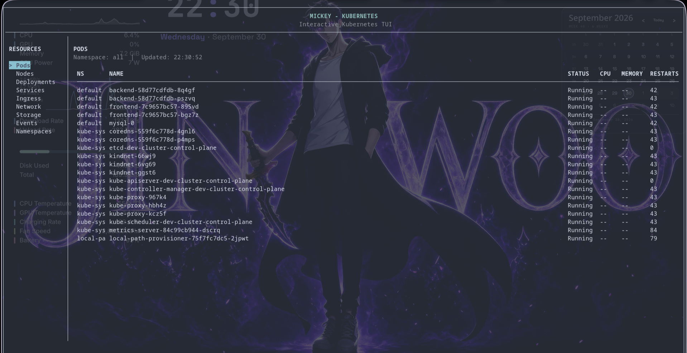
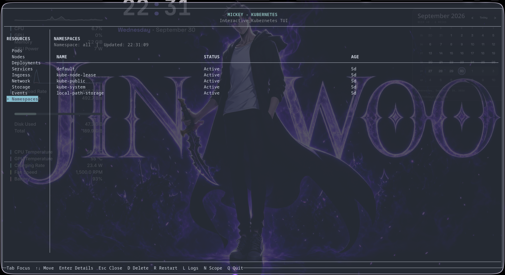

# Mickey

Mickey is a terminal-based Kubernetes dashboard built with Python and curses. It lets you inspect cluster resources from the terminal without opening a browser or writing custom `kubectl` commands for every view.

## What it does

The app connects to your Kubernetes cluster and shows a live list of resources such as:

- pods
- deployments
- services
- namespaces
- nodes
- statefulsets
- daemonsets

It renders a simple interactive UI in the terminal with:

- a resource sidebar
- a table of current items
- keyboard navigation
- detail popups for selected resources
- quick actions such as delete, restart, and logs

## Use cases

Mickey is useful when you want to:

- quickly inspect cluster state from a terminal
- monitor active workloads without using a browser UI
- view pod or deployment metadata and status in one place
- open logs or perform common actions from a lightweight TUI
- work in constrained environments where a GUI is not available

## Typical workflow

1. Run the app:
   - `mickey`
   - or `python3 mickey.py`
2. Use the arrow keys to move between resource categories and rows.
3. Press `Tab` to switch focus between the sidebar and the table.
4. Press `Enter`:
   - on the sidebar to switch resource groups
   - on a selected row to open details
5. Press `Esc` to close the detail popup.
6. Use keys like:
   - `D` to delete
   - `R` to restart
   - `L` to view logs
   - `N` to switch namespace
   - `Q` to quit

## Why this project exists

This project is designed for developers and operators who live in the terminal and need a fast way to inspect Kubernetes resources. It reduces the friction of repeatedly running `kubectl get ...` and `kubectl describe ...` commands by packing the most common actions into one interactive interface.

## Project structure

- `mickey.py` – main application logic and UI
- `mickey` – host launcher script used to run the app from the system PATH
- `Dockerfile` – container build for running the app inside Docker
- `.dockerignore` – excludes unnecessary files from Docker builds

## How it runs

The application is designed to run either:

- directly on the host through the `mickey` command, or
- inside Docker with the required kubeconfig and host networking access

This allows it to work with your local Kubernetes context while keeping the app easy to launch.

## Example command

```bash
mickey
```

This starts the interactive dashboard using your current Kubernetes configuration.


